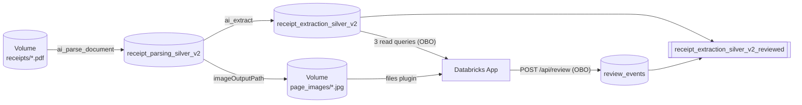

# Intelligent Document Extraction Review

A Databricks App for business reviewers to verify `ai_extract` output against the page it
came from. The review form is generated from the extraction schema **at runtime**, so
pointing it at a different extraction table reshapes the UI with no code change.

Built with [AppKit](https://developers.databricks.com/docs/appkit/v0/) (Node/TypeScript +
React 19), plugins `analytics` + `files` + `server`, on-behalf-of-user auth.

## Features

- **Runtime schema discovery** - no field name appears anywhere in the code. `fields.obo.sql`
  explodes the `VARIANT` response and reports each field's type; widgets follow from the type.
- **Evidence on the page** - each value's `ai_extract` citation is drawn as a box on the page
  image from `ai_parse_document`'s `imageOutputPath`. Boxes are coloured by the worst
  confidence in the region and labels are placed to avoid overlapping.
- **Arrays flattened to editable leaves** - `line_items[3].amount` is its own row with its own
  value, confidence and citation, because `ai_extract` puts the wrapper on array leaves.
  A 2-item receipt renders 10 rows, a 24-item hotel folio 54, unchanged.
- **Confidence triage** - queue sorts by outstanding work; values below threshold are flagged.
  Thresholds live in one place (`lib.ts` `BAND_DEFS`) and the legend text is derived from them.
- **Blocked approval** - a value the model never found must be filled in before the document
  can be approved; nothing is silently cleared.
- **Append-only audit** - every reviewed value is logged with reviewer, original, corrected and
  a `changed` flag. Corrections double as an MLflow evaluation dataset.
- **Per-reviewer scope** - a reviewer sees only their own review state, so one reviewer's answer
  cannot anchor another's.

## Lineage



| Object | Kind | Contains |
|---|---|---|
| `…idp_review.receipts` | Volume | Source PDFs. |
| `…receipt_parsing_silver_v2` | Table | `id`, `response` VARIANT - `ai_parse_document` output: page text, element bboxes, page `image_uri`. |
| `…idp_review.page_images` | Volume | One JPEG per page, written by `imageOutputPath`. The app serves these as the review image. |
| `…receipt_extraction_silver_v2` | Table | `id`, `response` VARIANT - `ai_extract` output. Per field `{value, confidence_score, citation_ids}`, plus `metadata.citations` (bbox + page) and `metadata.pages` (`image_uri`). The app's only read source. |
| `…review_events` | Table | Append-only log: `reviewed_at`, `reviewer`, `document_id`, `field_path`, `original_value`, `corrected_value`, `confidence`, `changed`. One row per reviewed value, never updated. |
| `…receipt_extraction_silver_v2_reviewed` | View | Final values, one row per value: `coalesce(human, model) AS value` plus `model_value`, `model_confidence`, `human_reviewed`, `human_changed`, `reviewer`, `reviewed_at`. Latest event wins. What downstream consumers read. |

The extraction table is **never** mutated. Review state is derived from the log, so nothing
depends on client session state.

### Auth, end to end

| Hop | Identity | Why |
|---|---|---|
| 3 read queries (`*.obo.sql`) | **signed-in user** | Unity Catalog applies the reviewer's own grants, and `current_user()` scopes review state to them. A plain `*.sql` would run as the app's service principal and the scope filter would match nothing. |
| `POST /api/review` | **signed-in user** via `appkit.asUser(req)` | UC attributes the insert to the reviewer. |
| `reviewer` column | `X-Forwarded-Email` header, server-side | Never accepted from the client. The write is a server route, not a query file, because any `config/queries/*.sql` is callable from the browser with arbitrary parameters - which would make the audit trail forgeable. |
| Page images | signed-in user, `files` plugin | `GET /api/files/files/raw?path=…` |

## Setup

1. **Create the log table and the view.** Edit the two table names in
   [`setup/setup.sql`](setup/setup.sql) and run it against your warehouse.
2. **Point the queries at your extraction table** - the table name is at the top of each of the
   three files in [`config/queries`](config/queries).
3. **Create the app with user authorization scopes `sql` and `files.files`.** Scopes are fixed at
   creation time and cannot be added later.
4. **Bind resources** (keys must match `app.yaml`): SQL warehouse as `sql-warehouse`, the
   page-image volume as `files`. Set `EXTRACT_TABLE` / `REVIEW_LOG_TABLE` in the app's
   environment. A Unity Catalog **table** can also be bound as a resource
   (`securable_type: TABLE`, `valueFrom` resolves to `catalog.schema.table`).

```bash
npm install
cp .env.example .env   # DATABRICKS_CONFIG_PROFILE, DATABRICKS_WAREHOUSE_ID, DATABRICKS_VOLUME_FILES, REVIEW_LOG_TABLE
npm run dev            # http://localhost:8000
databricks apps deploy <app-name>
```

## Implementation notes

Things that are deliberate, and cost time to find:

- **Analytics result caching is off** (`server.ts`). AppKit caches every query result for an hour
  by default; in a review queue that means an approved document stays in the queue and reviewers
  cannot see their own writes.
- **`useAnalyticsQuery` has no refetch.** Remounting reuses the cached snapshot, so a successful
  write is reflected by an optimistic local marker until the next load; durable state comes from
  the log.
- **VARIANT colon paths collide with AppKit's `:param` markers** - use `variant_get()` only.
- **Generated query types lie** about arrays and nullability (`ARRAY<BIGINT>` arrives as a JSON
  string), so every row is normalised at the boundary in `lib.ts`.
- **Numbers use `type="text"`** - a native number input coerces DECIMAL to float, turning
  `109303.32` into `109303.3203125`.
- **Bbox overlay colours are fixed hex, not theme tokens** - they sit on an always-white page
  image.
- **No dropdown widget**: `ai_extract` stores `enum` as `STRING`, so a closed enum is
  indistinguishable from a low-cardinality string, and constraining a reviewer to seen values
  would block the correction they came to make.

## Known gaps

- No claim or lock on a document: two reviewers can review the same one, and the view resolves
  by recency.
- Cross-page citation resolution is implemented but untested end to end - no field in the sample
  corpora cites page 2.
- `ai_classify` output fits the queries but not the product: it returns a bare `STRING`, so there
  is no confidence to triage on and no citation to draw.
